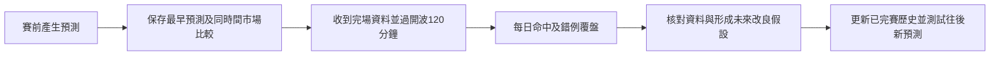

# 每日賽前模擬與完賽覆盤（2026-11-05）

目標係持續記錄真賽前預測，在完賽後識別錯誤，再用後續比賽檢驗改善。每日研究循環沿用現有 GitHub 工作流程；正式投注推薦仍保持 DISABLED／HOLD。

## 每日自動流程

- 既有 iPhone workflow 每日定期更新，UTC 01:17／07:17／13:17／19:17，即香港09:17／15:17／21:17／翌日03:17；成功資料採集亦可觸發。GitHub排程可能延遲。同一賽事用最早封存預測評分，重複刷新不會新增一場樣本。
- `shadow_forecast` 只用香港昨日或更早日期、已有 FINISHED 賽果嘅歷史估計攻守數值，訓練最少30場、固定 prior=6。新完場資料會進入之後預測的訓練輸入；已封存預測、ABC固定權重及D固定protocol保留作比較。
- `forward_validation` 等候完場資料並保留原有開波後120分鐘門檻及來源／身份／衝突檢查，將結果接到原賽前預測；來源未獨立認證的結果維持研究標籤。
- 同一發布流程執行 `forward_daily_scorecard`，產生 `forward_daily_scorecard.json` 同中文 `daily-review.html`，首頁有「每日模擬覆盤」連結。此步只讀既有封存結算輸入，沒有新增供應商查詢或額外排程。

## 本次補上的覆盤

既有每日scorecard只提供整體／每日數值；本次新增原模型A與同時間市場基準的共同樣本錯誤回顧：每日命中／未中、四種模型與市場對錯組合、3×3混淆方向，以及最多10宗原模型損失較大的錯例。逐場JSON保留原key、原預測／市場／開波時間、概率及觀察結果，方便追查；中文頁顯示每日摘要，沒有憑未核對譯名展示球隊。

A／市場直接使用原封存觀察，評分正規化沿用既有規則。原scorecard的0／0.5／0.75／1市場混合比較保持「事後重建」標籤，不能當成四個另外封存的ABC／市場模型。現有research_center的校準／主場偏差報告繼續沿用。

亦補強scorecard自己的時間檢查：每筆輸入的開波時間＋120分鐘必須不遲於 `checked_utc`；未到期輸入直接拒絕。這項consumer約束不代表此前真ledger受污染；原生產上游已有同一等待門檻。無樣本時顯示HOLD／資料不足，統計為null。

## 錯誤如何用於改善

每日回顧先區分模型錯而市場中、模型中而市場錯、兩者皆錯及皆中，識別要核對的方向。這些是描述性觀察，不能單憑一次落敗斷言原因。資料身份／時間／解析問題可成為獨立修復工單；算法改動應成為新版本／challenger，以之後的新比賽比較。現有模型已持續吸收早於當日的新完場歷史。

覆盤不會以同一批賽果即時調整封存ABC權重或自動提升模型。它亦沒有宣稱GitHub助理會每日自行重寫程式；持續運行的是已設定的資料更新、預測、封存及覆盤流程。

## 驗收與限制

本輪前的真研究基線有77場、20個香港比賽日：模型A命中37場、市場基準45場。結果尚未獨立認證，這些數字不能代表可成交盈利或認證優勢。

驗收包括未到期資料拒收、120分鐘邊界、跨香港日期、共同分母／錯誤分類、混淆矩陣、錯例排序及數量上限、原輸入與原統計不變、重複身份拒收、空樣本、中文頁及首頁連結重複執行。完整測試、獨立精確版本覆核、相關CI與真正新發布驗收由主助理保留在PR及交付紀錄。

完成每日研究覆盤不需要先達正式推薦的300認證樣本等門檻；正式資格、來源認證及最終人工審核仍另按既有規則驗收。未有證據證明本次工具改動會提高命中率。
