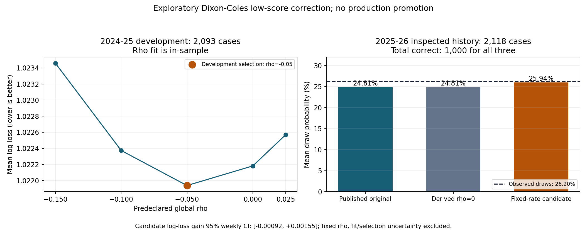

# 低比分修正歷史候選：命中未提高，輕微誤差改善未獲證實

已加入獨立 `dixon-coles-5dp-retrospective-v1`，並用同一批固定來源完成實際復盤。2025–26 評估的 2,118 場，候選與原模型同樣命中 1,000 場（47.21%）。平均和局概率更接近實際比例，但整體對數損失改善很小，95% 區間跨零；因此只保留研究候選，沒有晉升模型或正式推薦。

## 參照公開系統後實際落地的做法

- [ScoreCast](https://github.com/Costasgk/ScoreCast#model-vs-market)：參考按時間復盤、Dixon–Coles 低比分相關性，以及用概率評分而非只報命中的方法；沒有重現其自報績效，沒有執行其資料採集器。
- [Penaltyblog](https://github.com/martineastwood/penaltyblog)／[goalmodel](https://github.com/opisthokonta/goalmodel)：延續既有的時間切分、Log Loss、Brier、RPS 和校準檢查。重用本系統已有評分器，沒有複製外部程式或新增套件。
- 每個聯賽使用同一個開發季選定參數；如個別聯賽變差，照樣保留結果。缺任何必要來源檔案時，整個候選不擬合並輸出 HOLD，避免靜默改變研究人口。

這是**固定入球率的四格低比分修正**，並非聯合擬合攻守強度、時間衰減等參數的完整 Dixon–Coles 系統。

## 固定實驗設計及資料

- OpenFootball CC0，固定來源版本 [`e6744429ee395bc86f247348c6184bb08d4eb361`](https://github.com/openfootball/football.json/tree/e6744429ee395bc86f247348c6184bb08d4eb361)，六聯賽 × 兩球季共 12 個檔案。重用上一輪已核對 SHA256 的原始位元組，本輪新增下載及商業 API 請求均為零。
- 4,618 筆來源紀錄，解析為 4,597 筆 FT；21 筆沒有可用完場比分而排除。熱身期／球隊歷史不足後，可預測開發季 2,093 場、評估季 2,118 場。英冠包含附加賽；來源 FT 並非經獨立認證的法定 90 分鐘比分。
- 原入球率仍由既有模型逐日只使用更早日期資料產生，同日及未來賽果不作該場特徵。本候選使用其已輸出的五位小數入球率，**不是還原封存原始比分分布，也不是獨立入球證據**。
- 使用原模型相同的 0–11 球 × 0–11 球格網，修正 0–0、0–1、1–0、1–1，檢查所有修正因子嚴格為正，再正規化並輸出七位小數。
- 預先固定全局 `rho = [-0.15, -0.10, -0.05, 0, 0.025]`。只按 2024–25 的**未四捨五入**平均 Log Loss 選參數；同分時依序取較小絕對值、較小 rho。選得 **−0.05**。不按 2025–26 或個別聯賽重新選參數。
- `rho=0` 必須與原 Poisson 函式在**相同五位小數輸入**完全一致。先與這個衍生基準比較，再與已發表原模型比較，分開計算率四捨五入的影響：2025–26 最大單一概率差為 `0.0000025`，首選方向分歧 0 場。

## 實際結果

2025–26 已看過的歷史評估；各列完全相同 2,118 場。概率評分越低越好。

| 模型 | 命中／命中率 | Log Loss | 三類 Brier | 正規化 RPS | 平均和局概率 |
| --- | --- | --- | --- | --- | --- |
| 已發表原 Poisson | 1,000／47.21% | 1.04157 | 0.62660 | 0.216203 | 24.81% |
| 五位率衍生 rho=0 基準 | 1,000／47.21% | 1.04157 | 0.62660 | 0.216203 | 24.81% |
| 固定率低比分候選 rho=−0.05 | 1,000／47.21% | 1.04130 | 0.62645 | 0.216179 | 25.94% |
| 只用過去賽果的聯賽頻率 | 909／42.92% | 1.08130 | 0.65438 | 0.229760 | 25.74% |

實際和局比例 26.20%。候選平均和局概率差由約 −1.39 個百分點收窄至 −0.26 個百分點；這只是整體均值，不表示每個概率區間都已校準。低和局首選召回率本身，也不能當成概率有錯的證據。

同場按 35 個日曆週配對 bootstrap，候選相對衍生 rho=0 基準的命中率增益 95% 區間為 **[−0.230, +0.245] 個百分點**；Log Loss 改善為 **[−0.00092, +0.00155]**。相對已發表原模型，四捨五入後區間相同。兩項均跨零，未證實候選優於原模型。正數表示候選較好：命中為「候選減基準」，Log Loss 為「基準減候選」。

六聯賽的 Log Loss 並非一致改善：

| 聯賽 | 原模型 | 候選 |
| --- | --- | --- |
| 英超 | 1.05098 | 1.04954 |
| 英冠（含附加賽） | 1.07200 | 1.07199 |
| 德甲 | 1.01873 | 1.01704 |
| 西甲 | 0.99715 | 0.99779 |
| 意甲 | 1.03994 | 1.04097 |
| 法甲 | 1.05307 | 1.05239 |

完整來源雜湊、參數表、四模型每類概率分箱、全局／各聯賽評分及配對區間見 [研究 JSON](research_reports/dixon_coles_challenger_2026_10_26.json)。

## 驗收與限制

- 11 項新候選測試、3 項接入測試均先紅後綠；全套 **1,917 項 ops + 157 項根目錄測試 = 2,074 項通過**，compileall、diff check 通過。
- 改變全部評估季有效賽果／入球率，開發季選參數與成績不變；拒絕錯季、重複案例、布林／非有限數值及非法修正因子。輸入不被修改。
- 實際 12 檔完整報告移除新增 `dixon_coles_challenger` 欄位後，與上一輪原報告完全相同。沒有修改已封存 A／B／C、原模型、固定權重、來源認證政策、免費額度或正式資格閘門。
- 既有歷史復盤 workflow 會一併產出候選；沿用原每週排程，沒有新增重複排程或供應商採集。
- 2024–25 的 rho 成績屬參數擬合樣本內。2025–26 早已看過，而且本次模型家族就是按其缺陷選擇，屬探索性歷史評估，**不是未看過的樣本外／前瞻實證**。每週 bootstrap 固定已選 rho，沒有涵蓋擬合及模型選擇不確定性。
- 來源只有日期並可被修訂，缺可信賽前可用時刻、實際開波、獨立法定 90 分鐘結果及同資訊截止的可成交市場；不能推出可執行 EV、ROI、跑贏市場或正式推薦資格。

**正式推薦仍為 DISABLED／HOLD。** 下一步研究應預先固定候選及選擇規則，另行封存未來預測，待真實獨立賽果後評分；不能再把已看過的 2025–26 稱為全新測試集。
