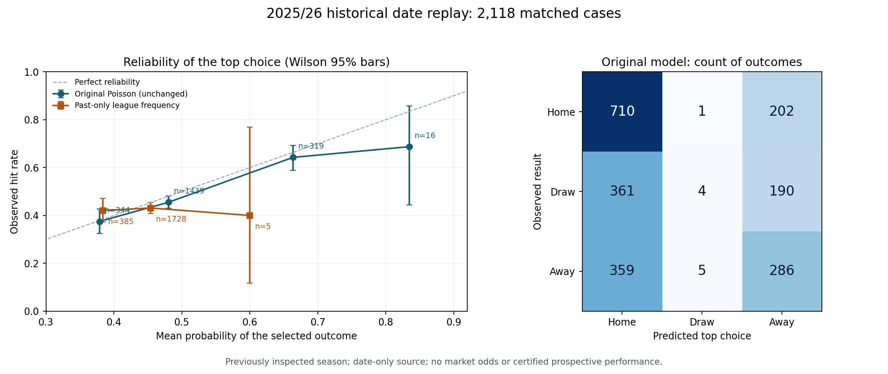

# 先預測、再復盤：六聯賽歷史錯誤診斷

本輪已實際用原有 `poisson-shrinkage-unvalidated-v4.1` 做日期遮罩重播，
補上逐場身份、混淆矩陣及可靠性分組。原模型、固定權重及已封存 A／B／C 預測不變。
這是歷史診斷；2025/26 以前已被檢視，不是新的未見賽果前瞻測試。

## 公開系統及資料庫對照

| 來源 | 本輪採用／查證 | 限制 |
| --- | --- | --- |
| [ScoreCast 原始 README](https://github.com/Costasgk/ScoreCast#model-vs-market) | 查到逐場 walk-forward、Log Loss／Brier 及可靠性圖做法，採用診斷思路，沿用本項目自己的模型／程式 | 未重跑其外部模型或採集腳本；其成績與軟件授權不等於本系統表現或資料權利 |
| [Penaltyblog 回測](https://penaltyblog.readthedocs.io/en/latest/backtest/backtest.html)、[goalmodel 評分](https://github.com/opisthokonta/goalmodel#evaluating-predictions) | 重用之前已核對的歷史窗口／樣本外評分概念 | 本系統本來已有重播及評分，今次沒有重造另一套引擎 |
| [OpenFootball](https://github.com/openfootball/football.json/tree/e6744429ee395bc86f247348c6184bb08d4eb361) | [CC0](https://github.com/openfootball/football.json/blob/e6744429ee395bc86f247348c6184bb08d4eb361/LICENSE.md)，實際使用固定 commit 的六聯賽、兩季12份 JSON | 無原生賽事 ID、可靠時區、實際開波或賽果公布時間；來源可修訂 |
| [StatsBomb Open Data](https://github.com/hudl/open-data) | 另查其原始 README／LICENSE.pdf，可作日後事件及 xG 研究來源候選 | 自訂非商業研究授權、禁止外傳原始資料，發布分析有署名／標誌要求；本輪沒有下載或加入其賽事資料 |

## 實際輸入及重播方式

固定資料版本 `e6744429ee395bc86f247348c6184bb08d4eb361`。
2024/25 保留為既有開發季，2025/26 保留為已檢視的歷史對照季；沒有按今次結果換季或挑聯賽。

- 12份來源共4,618筆原始紀錄；既有 parser 接受4,597筆完場欄位，21筆因缺有效完場比分而排除。
- 實際評分4,211次：開發季2,093場、對照季2,118場；其餘因初期歷史不足或球隊出現次數不足而棄權。
- 英冠每季557筆包括552場常規賽及5場附加賽，不能把整批描述成純常規賽或已認證90分鐘結果。
- 每個來源日期先只用較早日期的比分計算當日預測，再揭開當日賽果評分；同日及未來比分不進訓練。
- 來源日期不證明當時資訊已公布。原引擎的合成香港時間只作模型介面轉接，沒有記成真實開波／預測時刻。
- 每場保留衍生 replay ID、來源主客名稱、訓練截止日及訓練資料 SHA256，ID 明示非供應商 native ID。

[完整 JSON 報告](research_reports/retrospective_error_diagnostics_2026_10_26.json) 包含12份來源路徑及 SHA256、
各聯賽／季別排除數、全部原評分、新可靠性分組及最多五個原模型相對歷史頻率基準多損失的可追溯個案。
source home／away 為資料配對識別，並非另建中文球隊顯示名單。

## 2025/26 對照季結果：同一批2,118場

| 方法 | 首選命中 | 命中率 | Log Loss（低較好） | 三分類 Brier（低較好） |
| --- | ---: | ---: | ---: | ---: |
| 原 Poisson 模型 | 1,000 | 47.21% | 1.04157 | 0.62660 |
| 只用較早日期的聯賽賽果頻率 | 909 | 42.92% | 1.08130 | 0.65438 |
| 既有固定和局概率 +3 個百分點候選 | 998 | 47.12% | 1.04121 | 0.62642 |

原模型在這批歷史資料比簡單頻率基準好；沒有歷史可成交盤口，不能據此聲稱跑贏市場或盈利。
原模型命中率的 Wilson 95% 區間為45.10%–49.34%，亦不是實時預測勝率承諾。

混淆矩陣：列為來源實際結果，欄為模型首選。

| 實際結果／模型首選 | 主勝 | 和局 | 客勝 |
| --- | ---: | ---: | ---: |
| 主勝 | 710 | 1 | 202 |
| 和局 | 361 | 4 | 190 |
| 客勝 | 359 | 5 | 286 |

## 找到的缺陷及可做的下一步

1. **和局首選召回很低。** 實際555場和局，只選10場為和局、命中4場，召回率0.72%。
   這反映首選分配，單憑低召回不能判定概率全錯；平均和局概率24.81%，實際比例26.20%，低約1.39個百分點。
   下一個研究候選可針對低比分相關性作 Dixon–Coles 類修正，另建 ID、只用開發資料選參數，
   再收新前瞻輸出；不能直接提高所有和局概率或改原封存。
2. **較高信心需要更多樣本核對。** 60%–80%組319場，平均信心66.36%、實際命中64.26%；
   80%–100%組只有16場，平均信心83.47%、命中11場（68.75%）。後者 Wilson 95% 約44.4%–85.8%，
   區間寬且包含平均信心，只列監察風險，不能聲稱已統計證實過度自信或據此調閾值。
3. **盲加和局概率並無清楚改善。** +3個百分點候選命中少2場；Log Loss 微降0.00036，
   週區塊重抽樣的改善95%區間為 -0.00274 至 +0.00353，跨零。
   開發季選出的歷史頻率混合權重為0，亦沒有新增改善。兩者均不升格。

新診斷會隨既有回測的 `evaluate_cohort()` 進入總體、分聯賽及既有每週報告，
沒有新增重複採集／排程。此輪沒有消耗現有商業盤口 API 額度。

## 復算及驗收

完整 JSON 的 `diagnostic_source_snapshot` 記錄資料 commit／執行時間，
`upstream_archives` 記錄每份檔案的季別、路徑及原始 SHA256。
可從以下格式取回固定原件，而不是以 master 新版本假稱重現同一次結果：

`https://raw.githubusercontent.com/openfootball/football.json/e6744429ee395bc86f247348c6184bb08d4eb361/2025-26/en.1.json`

按 `LEAGUE_FILES` 讀取兩季12份原件，以 `docs[(season,league)]=(json_document,sha256)` 傳入
既有 `retrospective_backtest.build(docs)`，即可重算本次核心結果。

新測試先重現缺少診斷／身份欄位，再驗證混淆方向、機率分組、原始累計後才四捨五入的 ECE、
缺身份不捏造個案、同日／未來改分不影響原概率或訓練 hash、輸入不變及原 consumer 相容。
本輪完整測試及獨立覆核結果以 PR 的實際交付紀錄為準。

正式可信賽果 admission、認證共同樣本統計、私人賽前至賽後原件保存及前瞻校準仍未完成。
這批歷史資料不會加入300場／12星期／4聯賽正式資格，沒有改結果來源政策或模型升格閘門。
正式推薦維持 HOLD／DISABLED；本輪改善了診斷，未證實新模型或實時命中率提高。
